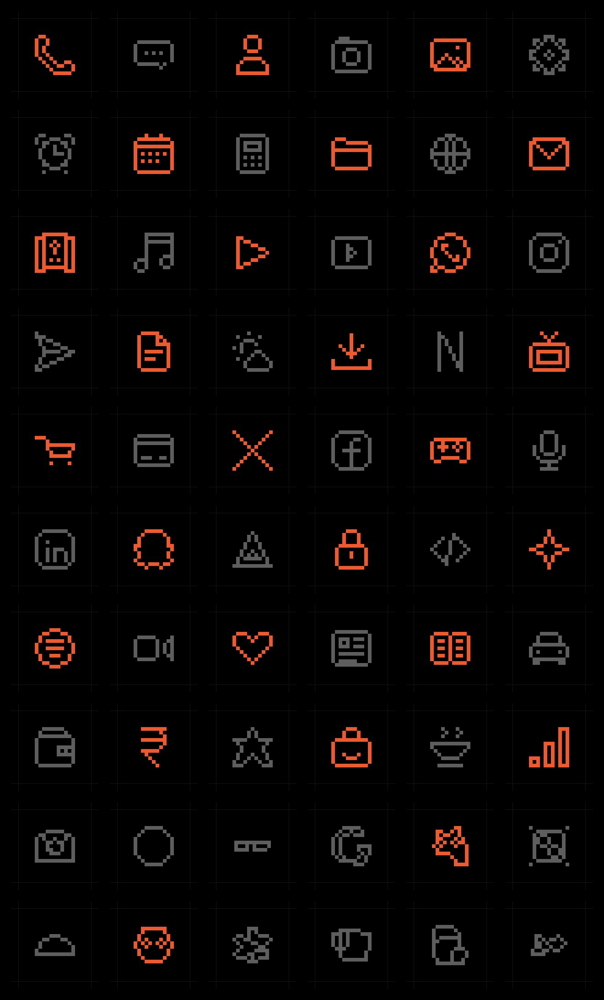
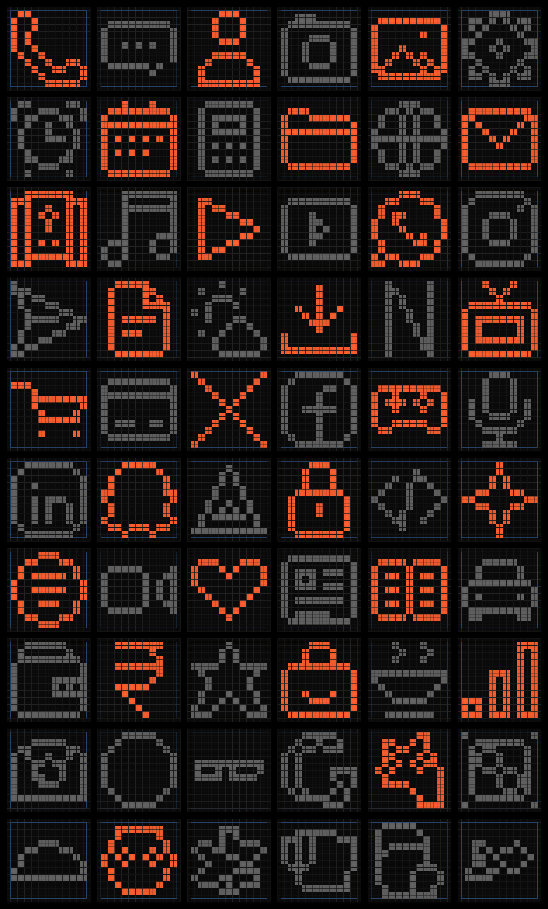
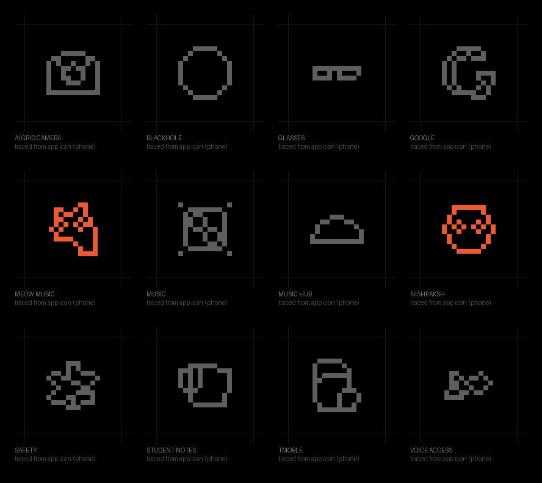
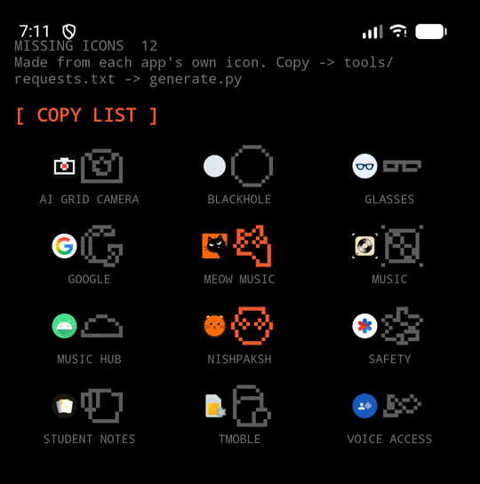

# Pixel Icons - Android icon pack

Pixel-art icon pack: black tiles, 2 px pixel outlines on a 24 px grid, orange + grey.
60 icons, 138 app mappings, plus a math system that makes an icon for any new app
**from that app's own icon**.

- [`PixelIcons.apk`](PixelIcons.apk) - install on the phone (allow "install unknown apps")

### Every icon on its grid

### Made by math from the apps' own icons

## Apply
Open **Pixel Icons** > tap **[ APPLY ]**, or in your launcher:
Nova / Lawnchair / Niagara / Smart Launcher > Settings > Icon pack > Pixel Icons.
(Stock Samsung/MIUI launchers don't support icon packs - use one of the above.)

## Design system (reference se naapa gaya)
`Pixel Icons #001` ko pixel-by-pixel naapa (`tools/reference_bitmaps.txt`):

| Cheez | Reference me | Is pack me |
|---|---|---|
| Icon grid | 24 px | 24 px |
| Stroke | 2 px (= 1 block) | 2 px (= 1 block) |
| Sabse bada icon | 22 px = 11 blocks | 11 blocks max |
| Pixel kitne | avg ~134 lit px / 576 (~34 blocks) | ~30-40 blocks |
| Corners | corner block khaali | corner block khaali |
| Gap | 1 block | 1 block |
| Dots | 1 block | 1 block |
| Orange | #EE5A2D | #EE5A2D |
| Grey | #5E5E5E | #5E5E5E |
| White | kahin nahi (sirf text grey #737373) | kahin nahi |
| Background / grid lines | #000000 / #141414 | #000000 / #141414 |
| Icon size in cell | 60 px of 138 px (43%) | 88 px of 192 px (46%) |
| Colour pattern | orange/grey checkerboard | orange/grey checkerboard |

Diagonals sirf 1:1 ya 2:1 steps me, taaki seedhiyan barabar rahein.
`keylines.png` = har icon grid pe. `compare.png` (reference vs pack) sirf local banta hai.

## Naye app ka icon - asli icon se, maths se (khud banta hai)
Jis app ka haath se bana icon nahi hai, uska icon **us app ke apne icon** se banta hai
(`tools/trace.py`, phone pe wahi maths `Tracer.java` me):

1. Asli icon 96x96 pe (adaptive icon ho to sirf uski foreground layer, beech ka 2/3).
2. Colours ko k-means (k <= 3) se 3 regions me baanto; transparent = background.
   Kinare pe 60% se zyada ek hi colour ho to woh bhi background.
3. Logo ke chaaron taraf square box -> 11x11 blocks; block ka label = majority colour
   (35% se kam bhara ho to khaali).
4. Outline: block jalta hai agar woh background ya kisi doosre colour region ko chhuta hai
   (colour border ek hi baar, 1 block).
5. Zhang-Suen thinning -> har line 1 block moti (pack ka stroke).
6. 60 se zyada blocks -> sirf bahar ki outline; 8 se kam -> bhara hua shape.
7. Colour: poore icon ka sabse bada colour garam (laal/orange/peela) -> orange, warna grey.

**Kaise use karein**
- Phone pe: Pixel Icons -> `[ MISSING ICONS ]` -> har app ka asli icon aur uska bana pixel icon
  dikhega -> `[ COPY LIST ]` -> `tools/requests.txt` me paste -> `python tools/generate.py` -> APK build.
- PC pe kisi icon PNG se: `python tools/new_icon.py "App Name" package/activity icon.png`
- `auto_icons.png` me saare auto-icons aur unka rule dikhta hai.
- Agar icon hi na ho to fallback: naam/package ke words se category glyph, ya hash se monogram (`tools/auto.py`).

## Unique designs
- **Maps**: tiha mudha kaagaz ka map + beech me location pin
- **Clock**: alarm clock - 9 block ka face, do ghantiyan (face se 1 block door), do pair
- **Settings**: 8 daant wala gear, beech me diamond hub (reference wale sliders `sliders` glyph me rakhe hain)

## Add or change icons
1. Add a function in `tools/icons.py` (11 x 11 block grid, shapes from `tools/geo.py` or `art()`).
2. Map it to apps in `tools/apps.py` (package/activity).
3. `python tools/generate.py`
4. `cd android` then `.\gradlew assembleRelease` -> `android/app/build/outputs/apk/release/app-release.apk`
